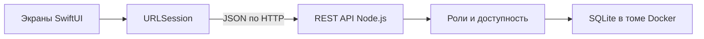

# Архитектура NEK

В SwiftUI клиентский кабинет и календарь администратора открываются после ответа сервера. Сервер выдаёт случайный токен сессии на восемь часов и хранит только его SHA-256. Токен находится в памяти приложения. Роль проверяется на сервере по сессии.

Запрос новых окон учитывает длительность выбранной услуги. Рабочий день — с 10:00 до 18:00 по Душанбе. Сетка стартов идёт с шагом 30 минут, последние окна доступны только для услуг, которые укладываются в смену. Мобильный клиент отправляет момент начала в UTC. Сервер сам рассчитывает конец и запрещает бронирование прошедших интервалов.

При сохранении транзакция SQLite начинается с `BEGIN IMMEDIATE`. Пересечение есть, если начало существующей записи раньше окончания новой, а её окончание позже начала новой. Окна соседних визитов могут соприкасаться. Запись считается подтверждённой после фиксации транзакции.

## API

| Метод и путь | Доступ | Результат |
| --- | --- | --- |
| GET `/api/health` | Все | Состояние сервера |
| POST `/api/session` | Все | Учётная запись и токен |
| DELETE `/api/session` | По токену | Отзыв токена |
| GET `/api/catalog` | По токену | Услуги, специалисты и доступные даты |
| GET `/api/slots?day=…&serviceId=…&masterId=…` | По токену | Свободные интервалы |
| POST `/api/bookings` | Клиент | Визит либо HTTP 409 при пересечении |
| GET `/api/bookings` | По токену | Записи текущего аккаунта |
| GET `/api/schedule?day=…` | Администратор | Записи за день |

Единственный сервис Compose публикует API на loopback Mac. Файл SQLite и журнал операций SQLite находятся в именованном томе. Данные и учётные записи предназначены для локального учебного запуска.
